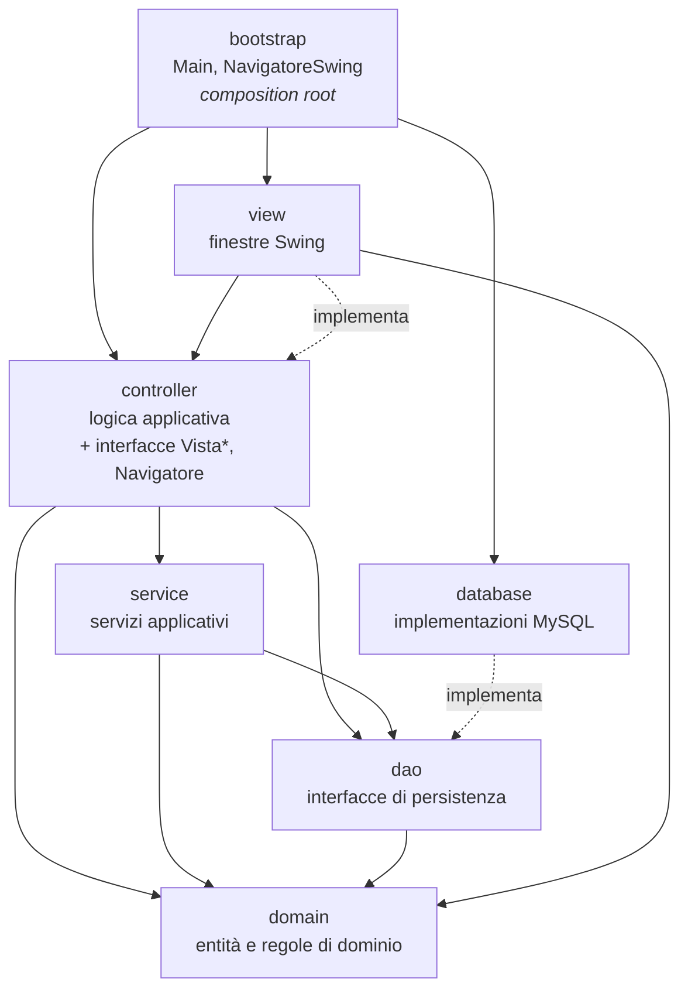

# ScriptActive

[](https://github.com/svilu999/Progetto-ScriptActive/actions/workflows/test.yml)

[English](README.md) · **Italiano**

Gestionale desktop per una catena di palestre, sviluppato da cinque studenti per il corso di
**Programmazione a Oggetti e Ingegneria del Software** dell'Università di Pavia.

L'applicazione è scritta in **Java 21** con interfaccia **Swing** e persistenza su **MySQL** via JDBC.
Non usa framework: l'architettura a livelli, l'iniezione delle dipendenze e i pattern sono
realizzati a mano, perché erano l'oggetto del corso.

## Funzionalità

| Attore | Che cosa può fare |
|---|---|
| Visitatore | Registrarsi scegliendo sede, tipo e durata dell'abbonamento, con pagamento simulato (UC1) |
| Cliente | Accedere, consultare il palinsesto, prenotare un corso o entrare in lista d'attesa, annullare una prenotazione (UC2) |
| Cliente Premium | Registrare le sessioni di allenamento e consultarne lo storico (UC4) |
| Direttore | Pubblicare e annullare corsi (UC3); assumere e licenziare Personal Trainer, riassegnarne i corsi a un sostituto, calcolare le retribuzioni mensili (UC5) |
| Personal Trainer | Accedere e consultare il palinsesto |
| Tutti | Autenticazione con instradamento per ruolo e rinnovo dell'abbonamento scaduto (UC6) |

L'analisi (visione, requisiti, casi d'uso, modello di dominio, diagrammi di classe, di sequenza ed ER)
è nella cartella [`ScriptActive/Documenti`](ScriptActive/Documenti).

## Architettura

Il codice è organizzato a livelli secondo **MVC**, con un livello di persistenza isolato dal pattern **DAO**.
I package sono sotto `ScriptActive/src/it/unipv/poingsfw`.



| Package | Responsabilità | Non deve conoscere |
|---|---|---|
| `domain` | Entità (`Utente`, `Cliente`, `Corso`, `Abbonamento`…) e regole di dominio (`Tariffario`) | Nessun altro strato, né Swing, né JDBC |
| `dao` | Interfacce di accesso ai dati | L'implementazione MySQL |
| `database` | Implementazioni MySQL dei DAO | View e controller |
| `service` | Servizi applicativi senza interfaccia utente (contratti del personale, retribuzioni, pagamenti, rinnovi) | View, controller, MySQL |
| `controller` | Logica dei casi d'uso; definisce le interfacce `Vista*` e `Navigatore` di cui ha bisogno | View concrete, Swing, MySQL |
| `view` | Finestre Swing: mostrano i dati e inoltrano i gesti dell'utente al controller | DAO e database |
| `bootstrap` | Avvio: crea gli oggetti concreti e li collega | — |

Queste regole non sono solo documentazione: le verifica
[`ArchitetturaTest`](ScriptActive/src/it/unipv/poingsfw/test/unit/ArchitetturaTest.java), che fallisce
indicando file e riga se un package importa uno strato che non deve conoscere.

### Come sono collegate le parti

- **Dependency Injection manuale.** Controller e servizi ricevono le dipendenze dal costruttore e
  conoscono solo interfacce. Gli oggetti concreti sono creati una sola volta in
  [`Main`](ScriptActive/src/it/unipv/poingsfw/bootstrap/Main.java), il *composition root*.
- **Navigazione.** Un controller decide *quando* cambiare schermata chiamando l'interfaccia
  `Navigatore`; *come* si costruisce la schermata lo sa solo `NavigatoreSwing`. Né le view né i
  controller si istanziano a vicenda.
- **Viste come interfacce.** I controller che aggiornano una schermata dipendono da un'interfaccia
  (`VistaLogin`, `VistaStoricoAllenamenti`, …) che la finestra Swing implementa. Nei test viene
  sostituita da un oggetto fittizio.

### Pattern utilizzati

| Pattern | Dove | A che cosa serve |
|---|---|---|
| MVC | `domain` / `view` / `controller` | Separare dati, presentazione e logica applicativa |
| DAO | `dao` + `database` | Isolare SQL e JDBC dal resto del sistema |
| Strategy | `strategy` | Calcolo della retribuzione dei trainer (fissa mensile o a lezione) |
| Double Dispatch | `Utente.accediAreaRiservata(InstradatoreUtente)` | Aprire l'area riservata giusta per ogni ruolo senza `instanceof` |
| Observer | `Corso` (Subject) / `Cliente` (Observer) | Notificare gli iscritti delle variazioni di un corso |
| Singleton | `DatabaseManager` | Unico punto di caricamento della configurazione JDBC |
| DTO | `dto` | Trasportare i dati dei trainer tra persistenza, servizi e controller |

## Come eseguirlo

**Requisiti:** JDK 21 e MySQL 8. Per compilare si può usare Eclipse (il progetto contiene
`.project` e `.classpath`) oppure Maven.

1. Crea e popola il database:

   ```bash
   mysql -u root -p < ScriptActive/database/schemadb.sql
   ```

   Lo script elimina e ricrea `scriptactive_db`. Le date dei dati di esempio sono relative al
   giorno in cui lo esegui, quindi i corsi sono sempre futuri e gli abbonamenti sempre validi.

2. Configura la connessione copiando il file di esempio e inserendo le tue credenziali:

   ```bash
   cp ScriptActive/src/db.properties.example ScriptActive/src/db.properties
   ```

   `db.properties` è escluso dal repository.

3. Avvia l'applicazione in uno dei due modi:

   - **Eclipse:** importa la cartella `ScriptActive` (*File → Import → Existing Projects into
     Workspace*) ed esegui la classe `it.unipv.poingsfw.bootstrap.Main`.
   - **Maven:** dalla cartella `ScriptActive` compila e poi lancia la classe principale.

     ```bash
     mvn -DskipTests package dependency:copy-dependencies -DincludeScope=runtime
     ```

     ```bash
     java -cp "target/scriptactive-1.0.0.jar:target/dependency/*" it.unipv.poingsfw.bootstrap.Main
     ```

     Su Windows il separatore del classpath è `;` al posto di `:`.

**Utenti di esempio** (password `1234` per tutti):

| Email | Ruolo |
|---|---|
| `direttore@scriptactive.it` | Direttore |
| `trainer@scriptactive.it` | Personal Trainer |
| `mario.rossi@email.it` | Cliente Premium |
| `lorenzo@studenti.unipv.it` | Cliente Base |

## Test

I test sono in `ScriptActive/src/it/unipv/poingsfw/test`. Si eseguono da Eclipse con
*Run As → JUnit Test* oppure con Maven dalla cartella `ScriptActive`:

```bash
mvn test
```

```bash
mvn test -Pintegrazione
```

Il primo comando esegue i test di unità; il secondo quelli di integrazione e di sistema, e
richiede il database.

| Package | Che cosa verifica | Che cosa richiede |
|---|---|---|
| `test.unit` | Controller, servizi e regole di architettura, con persistenza e viste fittizie | Niente: né database né display |
| `test.integration` | Controller assemblati con i DAO MySQL reali | MySQL popolato con `schemadb.sql` |
| `test.system` | Casi d'uso di login e storico allenamenti dal controller al database | MySQL popolato con `schemadb.sql` |
| `test.fake` | Implementazioni in memoria di DAO, viste e navigazione usate dai test | — |

I test di integrazione modificano il database: riesegui `schemadb.sql` dopo averli lanciati.

A ogni push su `main` e a ogni pull request, una GitHub Action
([`.github/workflows/test.yml`](.github/workflows/test.yml)) esegue entrambe le suite: quella di
integrazione su un MySQL temporaneo creato per l'occasione.

Il progetto conserva la struttura di Eclipse, con codice e test sotto la stessa cartella `src`:
il `pom.xml` li distingue in base al package `test`.

## Storia del progetto

La versione consegnata all'esame funzionava ma violava in più punti la separazione MVC.
Il progetto è stato poi rivisto per correggerla:

| Problema nella versione consegnata | Correzione |
|---|---|
| Alcune view istanziavano i DAO MySQL e interrogavano il database | Le view ricevono i dati dal controller; nessuna view importa `dao` o `database` |
| I controller creavano i DAO MySQL con `new` o tramite Singleton | Dipendenze passate dal costruttore; i Singleton dei controller sono stati rimossi |
| I controller costruivano le finestre Swing e i relativi listener | Interfacce `Vista*` e `Navigatore`; le finestre sono create solo in `bootstrap` |
| Il dominio dipendeva da un controller (`Utente.accediAreaRiservata(LoginController)`) | Il parametro è ora un'interfaccia del dominio, `InstradatoreUtente` |
| `System.out` nei controller e `Main` nel package `domain` | Logging con `java.util.logging`; `Main` spostato in `bootstrap` |
| I test di unità richiedevano MySQL e un display, e due si bloccavano su un dialog modale | I test di unità usano oggetti fittizi e girano in automatico |

Durante la revisione sono stati corretti anche alcuni difetti di comportamento: la registrazione
segnalava successo anche quando il salvataggio falliva; chiudere il palinsesto, la registrazione
o il rinnovo terminava l'applicazione invece di tornare alla schermata precedente; il palinsesto
aperto senza un cliente autenticato andava in errore alla prenotazione.

## Limiti noti

Il progetto è un prototipo didattico. Questi aspetti non sono stati affrontati:

- **Password in chiaro.** La colonna si chiama `PasswordHash` ma contiene la password così com'è.
- **Connessioni JDBC.** Diversi DAO aprono una connessione per ogni operazione senza chiuderla e
  non usano un pool.
- **Errori di persistenza.** Molti DAO intercettano le `SQLException`, le stampano e restituiscono
  un valore neutro: il chiamante non sempre può distinguere "nessun risultato" da "errore".
- **Pagamenti simulati.** Il sistema di pagamento è uno stub: rifiuta gli IBAN che contengono `ERRORE`.
- **Rinnovo manuale.** La schermata di rinnovo mostra prezzi propri e non addebita tramite il
  sistema di pagamento; l'upgrade da Base a Premium non è implementato.
- **Rinnovi automatici in background.** `GestoreRinnovi` è implementato e testato ma non viene
  avviato da `Main`.
- **Documentazione UML.** I diagrammi in `Documenti` descrivono la versione consegnata all'esame
  e non riportano le classi introdotte con la revisione.
