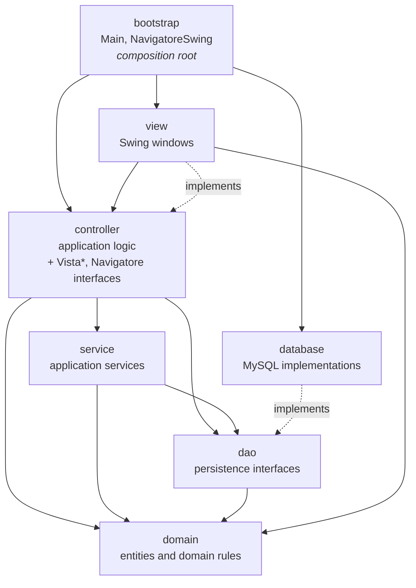

# ScriptActive

[](https://github.com/svilu999/Progetto-ScriptActive/actions/workflows/test.yml)

**English** · [Italiano](README.it.md)

A desktop management system for a chain of gyms, built by five students for the
**Object-Oriented Programming and Software Engineering** course at the University of Pavia, Italy.

The application is written in **Java 21** with a **Swing** user interface and **MySQL** persistence
over JDBC. It uses no frameworks: the layered architecture, dependency injection and design
patterns are implemented by hand, because they were the subject of the course.

> **A note on language.** This was an Italian university project, so class names, method names,
> comments and the user interface are in Italian. The [glossary](#glossary) below maps the terms
> you will meet most often in the code.

## Features

| Actor | What they can do |
|---|---|
| Visitor | Sign up by choosing a gym location, membership type and duration, with a simulated payment (UC1) |
| Member | Log in, browse the course schedule, book a course or join its waiting list, cancel a booking (UC2) |
| Premium member | Record workout sessions and review their history (UC4) |
| Manager | Publish and cancel courses (UC3); hire and dismiss personal trainers, reassign their courses to a substitute, compute monthly payroll (UC5) |
| Personal trainer | Log in and browse the course schedule |
| Everyone | Authentication with role-based routing, and renewal of an expired membership (UC6) |

The analysis documents (vision, requirements, use cases, domain model, class, sequence and ER
diagrams) are in [`ScriptActive/Documenti`](ScriptActive/Documenti), in Italian.

The class and sequence diagrams match the current code. The class diagram is generated from the
sources by
[`GeneraDiagrammaClassi.java`](ScriptActive/Documenti/07.%20Diagramma%20delle%20Classi/GeneraDiagrammaClassi.java),
so it can be regenerated after any change. The PDF documents (vision, requirements, use cases,
presentation) are the ones submitted for the exam.

## Architecture

The code is layered according to **MVC**, with persistence isolated behind the **DAO** pattern.
The packages live under `ScriptActive/src/it/unipv/poingsfw`.



| Package | Responsibility | Must not know about |
|---|---|---|
| `domain` | Entities (`Utente`, `Cliente`, `Corso`, `Abbonamento`…) and domain rules (`Tariffario`) | Any other layer, Swing or JDBC |
| `dao` | Data access interfaces | The MySQL implementation |
| `database` | MySQL implementations of the DAOs | Views and controllers |
| `service` | Application services with no user interface (staff contracts, payroll, payments, renewals) | Views, controllers, MySQL |
| `controller` | Use-case logic; defines the `Vista*` and `Navigatore` interfaces it depends on | Concrete views, Swing, MySQL |
| `view` | Swing windows: display data and forward user actions to the controller | DAOs and the database |
| `bootstrap` | Startup: creates the concrete objects and wires them together | — |

These rules are more than documentation: they are enforced by
[`ArchitetturaTest`](ScriptActive/src/it/unipv/poingsfw/test/unit/ArchitetturaTest.java), which
fails with the offending file and line if a package imports a layer it must not know about.

### How the parts are wired

- **Manual dependency injection.** Controllers and services receive their dependencies through
  the constructor and only know interfaces. Concrete objects are created once in
  [`Main`](ScriptActive/src/it/unipv/poingsfw/bootstrap/Main.java), the *composition root*.
- **Navigation.** A controller decides *when* to change screen by calling the `Navigatore`
  interface; only `NavigatoreSwing` knows *how* a screen is built. Views and controllers never
  instantiate each other.
- **Views as interfaces.** Controllers that update a screen depend on an interface
  (`VistaLogin`, `VistaStoricoAllenamenti`, …) implemented by the Swing window. In tests it is
  replaced by a fake.

### Design patterns

| Pattern | Where | What it is for |
|---|---|---|
| MVC | `domain` / `view` / `controller` | Separating data, presentation and application logic |
| DAO | `dao` + `database` | Isolating SQL and JDBC from the rest of the system |
| Strategy | `strategy` | Computing trainer pay (fixed monthly or per lesson) |
| Double Dispatch | `Utente.accediAreaRiservata(InstradatoreUtente)` | Opening the right area for each role without `instanceof` |
| Observer | `Corso` (Subject) / `Cliente` (Observer) | Notifying enrolled members when a course changes |
| Singleton | `DatabaseManager` | Single loading point for the JDBC configuration |
| DTO | `dto` | Carrying trainer data between persistence, services and controllers |

## Getting started

**Requirements:** JDK 21 and MySQL 8. You can build with Eclipse (the project includes `.project`
and `.classpath`) or with Maven.

1. Create and populate the database:

   ```bash
   mysql -u root -p < ScriptActive/database/schemadb.sql
   ```

   The script drops and recreates `scriptactive_db`. Sample data uses dates relative to the day
   you run it, so courses are always in the future and memberships are always valid.

2. Configure the connection by copying the example file and filling in your credentials:

   ```bash
   cp ScriptActive/src/db.properties.example ScriptActive/src/db.properties
   ```

   `db.properties` is excluded from the repository.

3. Start the application in one of two ways:

   - **Eclipse:** import the `ScriptActive` folder (*File → Import → Existing Projects into
     Workspace*) and run the class `it.unipv.poingsfw.bootstrap.Main`.
   - **Maven:** from the `ScriptActive` folder, build and then launch the main class.

     ```bash
     mvn -DskipTests package dependency:copy-dependencies -DincludeScope=runtime
     ```

     ```bash
     java -cp "target/scriptactive-1.0.0.jar:target/dependency/*" it.unipv.poingsfw.bootstrap.Main
     ```

     On Windows the classpath separator is `;` instead of `:`.

**Sample users** (password `1234` for all of them):

| Email | Role |
|---|---|
| `direttore@scriptactive.it` | Manager |
| `trainer@scriptactive.it` | Personal trainer |
| `mario.rossi@email.it` | Premium member |
| `lorenzo@studenti.unipv.it` | Basic member |

## Tests

Tests live in `ScriptActive/src/it/unipv/poingsfw/test`. Run them from Eclipse with
*Run As → JUnit Test*, or with Maven from the `ScriptActive` folder:

```bash
mvn test
```

```bash
mvn test -Pintegrazione
```

The first command runs the unit tests; the second runs the integration and system tests, and
needs the database.

| Package | What it checks | What it needs |
|---|---|---|
| `test.unit` | Controllers, services and architecture rules, with fake persistence and views | Nothing: no database, no display |
| `test.integration` | Controllers wired to the real MySQL DAOs | MySQL populated with `schemadb.sql` |
| `test.system` | Login and workout-history use cases, from controller to database | MySQL populated with `schemadb.sql` |
| `test.fake` | In-memory implementations of DAOs, views and navigation used by the tests | — |

Integration tests modify the database: run `schemadb.sql` again after them.

On every push to `main` and on every pull request, a GitHub Action
([`.github/workflows/test.yml`](.github/workflows/test.yml)) runs both suites, the integration
one against a temporary MySQL instance created for the run.

The project keeps its Eclipse layout, with application code and tests under the same `src`
folder: the `pom.xml` tells them apart by the `test` package.

## Project history

The version submitted for the exam worked, but broke MVC separation in several places.
The project was later revised to fix that:

| Problem in the submitted version | Fix |
|---|---|
| Some views instantiated MySQL DAOs and queried the database | Views get their data from the controller; no view imports `dao` or `database` |
| Controllers created MySQL DAOs with `new` or through Singletons | Dependencies are passed through the constructor; controller Singletons were removed |
| Controllers built Swing windows and their listeners | `Vista*` and `Navigatore` interfaces; windows are created only in `bootstrap` |
| The domain depended on a controller (`Utente.accediAreaRiservata(LoginController)`) | The parameter is now a domain interface, `InstradatoreUtente` |
| `System.out` in controllers, and `Main` in the `domain` package | Logging through `java.util.logging`; `Main` moved to `bootstrap` |
| Unit tests needed MySQL and a display, and two of them hung on a modal dialog | Unit tests use fakes and run unattended |

The revision also fixed a few behavioural defects: sign-up reported success even when saving
failed; closing the schedule, sign-up or renewal window quit the application instead of going
back to the previous screen; the schedule opened without a logged-in member crashed on booking.

## Known limitations

This is a teaching prototype. The following were not addressed:

- **Plain-text passwords.** The column is called `PasswordHash` but stores the password as typed.
- **JDBC connections.** Several DAOs open a connection per operation without closing it, and
  there is no connection pool.
- **Persistence errors.** Many DAOs catch `SQLException`, print it and return a neutral value,
  so the caller cannot always tell "no result" from "error".
- **Simulated payments.** The payment system is a stub: it rejects any IBAN containing `ERRORE`.
- **Manual renewal.** The renewal screen shows its own prices and does not charge through the
  payment system; upgrading from Basic to Premium is not implemented.
- **Background auto-renewal.** `GestoreRinnovi` is implemented and tested but is not started by
  `Main`.
- **Sequence diagrams.** They are written by hand and must be updated if the flows they
  describe change.

## Glossary

| Italian | English |
|---|---|
| `Utente`, `Cliente`, `Direttore` | User, member (customer), manager |
| `Abbonamento`, `Rinnovo` | Membership (subscription), renewal |
| `Corso`, `Palinsesto` | Course, course schedule |
| `Prenotazione`, lista d'attesa | Booking, waiting list |
| `Sede` | Gym location |
| `SessioneAllenamento`, `Storico` | Workout session, history |
| `Registrazione` | Sign-up |
| `Pagamento`, `Tariffario` | Payment, price list |
| `Retribuzione`, `Contratto` | Pay, contract |
| `Gestore…` | "Manager of…": a controller or service for one area |
| `Vista`, `Navigatore` | View, navigator |
| `Instradatore` | Router |
